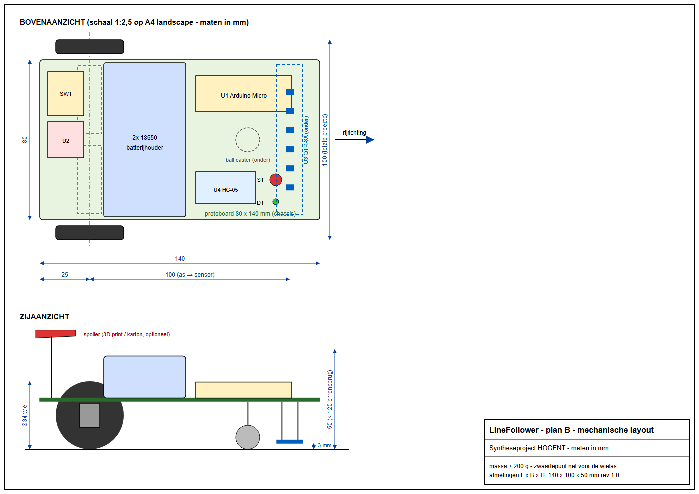

# LineFollower

Autonome linefollower robot - syntheseproject HOGENT - **plan B**: een volledig werkende robot opgebouwd met breakout boards op een protoboard-chassis, met PID regeling, draadloze bediening via bluetooth en instellingen in EEPROM.

## specifications

| | |
|---|---|
| **microcontroller** | Arduino Micro (ATmega32U4, 16 MHz, 5V) |
| **motors** | 2x N20 micro metal gear motor 6V 1000 rpm |
| **h-bridge** | DRV8833 breakout (dubbele mosfet h-brug, 1,5A/kanaal) |
| **sensors** | QTR-8A analoge IR sensor array, 6 middelste sensoren (QRE1113), 9,525 mm afstand |
| **batteries** | 2x 18650 Li-ion in serie (7,4V nominaal, 8,4V vol) |
| **wireless communication** | HC-05 bluetooth classic (SPP, 9600 baud) + web app in de browser |
| **distance sensor - motors** | 100 mm (sensor voor de wielas) |
| **weight** | ± 200 g |
| **dimensions** | 140 x 100 x 50 mm (L x B x H) - past onder de chronobrug (12 x 12 cm) |
| **speed** | doel ≥ 0,8 m/s (theoretische topsnelheid ± 1,5 m/s) - zie [testresultaten](#testresultaten) |
| **kostprijs** | ± 48 € (zie [bill of materials](bill%20of%20materials/readme.md)) |

## waarom deze keuzes? (snelheid)

* **N20 1000 rpm + wielen Ø34 mm**: 1000 rpm × π × 34 mm ≈ 1,78 m/s onbelast. Belast en begrensd blijft er ruim reserve boven de 1 m/s.
* **2S Li-ion (8,4V) met software-begrenzing**: de motoren krijgen max. ± 7V (`MAX_PWM`), dus een vrijwel constante topsnelheid, ook als de batterij leeg raakt.
* **DRV8833 (mosfet)**: slechts 0,36 Ω verlies tegenover ± 2-3V spanningsval bij een L298. Er gaat dus meer spanning naar de motoren.
* **QTR-8A analoog + kwadratische interpolatie**: 6 sensoren uitlezen kost ± 0,7 ms. Zo is een cyclustijd van 2,5 ms (400 Hz) haalbaar en is de positie veel fijner dan de sensorafstand.
* **sensor 100 mm voor de wielas**: de robot ziet een bocht vroeger aankomen. Dat geeft een stabielere regeling bij hoge snelheid.
* **licht en laag** (± 200 g, zwaartepunt net voor de wielas): sneller optrekken en minder slippen in de bochten.
* **software**: PID met gefilterde D-term, *boost* op rechte stukken, detectie van een verloren lijn (de robot zoekt terug naar de kant waar hij de lijn laatst zag) en van kruispunten (rechtdoor rijden + rondetijd meten).

## inhoud van deze repository

| map | inhoud |
|---|---|
| [bill of materials](bill%20of%20materials/readme.md) | alle onderdelen, aantallen, aankoopbron en prijs ([csv](bill%20of%20materials/bom.csv)) |
| [technische tekeningen/elektronisch](technische%20tekeningen/elektronisch/readme.md) | elektronisch schema ([pdf](technische%20tekeningen/elektronisch/schema_planB.pdf) + [svg bron](technische%20tekeningen/elektronisch/schema_planB.svg)) |
| [technische tekeningen/mechanisch](technische%20tekeningen/mechanisch/readme.md) | mechanische layout ([pdf](technische%20tekeningen/mechanisch/mechanisch_planB.pdf) + [svg bron](technische%20tekeningen/mechanisch/mechanisch_planB.svg)) |
| [code/proof of concepts](code/proof%20of%20concepts/readme.md) | blink, h-brug, sensor, start/stop interrupt, draadloze communicatie |
| [code/basis](code/basis/readme.md) | basisprogramma: SerialCommand + EEPROM + vaste cyclus + interrupt |
| [code/finaal](code/finaal/readme.md) | finale linefollower code (sensor, PID, motoren) |
| [code/app](code/app/readme.md) | bedieningsprogramma (web app, Chrome/Edge) |
| [instructable](instructable/readme.md) | stappenplan om de robot na te bouwen |
| [gebruiksaanwijzing](gebruiksaanwijzing/readme.md) | gebruik, commando's, kalibratie, instellingen |
| [datasheets](datasheets/readme.md) | datasheets van alle gebruikte componenten |
| [parcours](parcours) | testparcours (pdf) |

## testresultaten

| datum | parcours | power / boost | Kp / Ki / Kd | rondetijd | gem. snelheid | opmerking |
|---|---|---|---|---|---|---|
| | | | | | | *in te vullen na het testen* |

> Prioriteit 1 uit plan B: eerst **3 toeren** foutloos rijden, pas daarna sneller maken (zie [gebruiksaanwijzing - tunen](gebruiksaanwijzing/readme.md#tunen-snel-en-betrouwbaar)).
