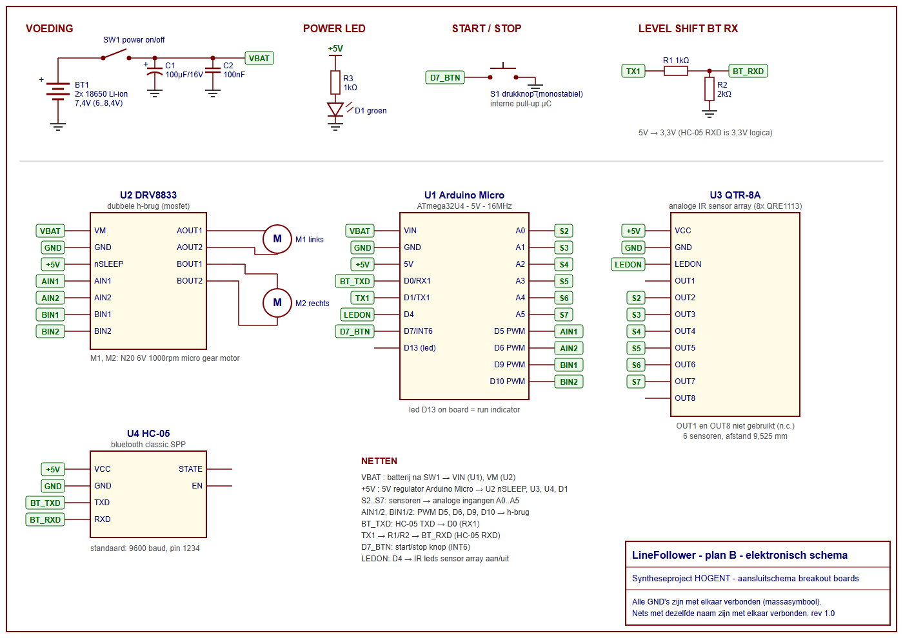

# elektronisch schema - plan B

* printout: [schema_planB.pdf](schema_planB.pdf)
* origineel bestand: [schema_planB.svg](schema_planB.svg). Het wordt gegenereerd door [../tools/genereer_tekeningen.js](../tools/genereer_tekeningen.js) (`node genereer_tekeningen.js`).
* `easyeda_linefollower_planB.json` is het voorbeeldschema uit de template (ter referentie).

## aansluitingen

| van | naar | net |
|---|---|---|
| batterij + (via SW1) | U1 VIN, U2 VM, C1, C2 | VBAT (6..8,4V) |
| batterij - | alle GND's | GND |
| U1 5V | U2 nSLEEP, U3 VCC, U4 VCC, R3 + D1 | +5V |
| U3 OUT2..OUT7 | U1 A0..A5 | S2..S7 |
| U1 D4 | U3 LEDON | LEDON |
| U1 D5 / D6 | U2 AIN1 / AIN2 | linker motor M1 |
| U1 D9 / D10 | U2 BIN1 / BIN2 | rechter motor M2 |
| U2 AOUT1 / AOUT2 | M1 | |
| U2 BOUT1 / BOUT2 | M2 | |
| U4 TXD | U1 D0 (RX1) | BT_TXD |
| U1 D1 (TX1) → R1 1k → | U4 RXD, R2 2k naar GND | BT_RXD (3,3V) |
| U1 D7 (INT6) | S1 → GND | D7_BTN |

## aandachtspunten (uit de proof of concepts)

* Alle GND's zijn fysiek met elkaar verbonden: batterij, Arduino, h-brug, sensor en bluetooth.
* Er zijn **2 positieve spanningen** die nooit met elkaar verbonden mogen worden:
  * **VBAT** (vermogen, rechtstreeks van de batterij naar de h-brug en VIN)
  * **+5V** (stuurspanning, van de spanningsregelaar van de Arduino Micro)
* De motoren worden **rechtstreeks uit de batterij** gevoed via de h-brug, nooit uit de 5V van de Arduino.
* De spanningsregelaar van de Arduino Micro (max. 12V in, ± 500 mA) levert de 5V. Verbruik op 5V: sensor ± 100 mA (IR leds), HC-05 ± 40 mA, led 3 mA → ruim binnen de grenzen.
* HC-05 RXD werkt op 3,3V logica: de spanningsdeler R1/R2 maakt van 5V ongeveer 3,3V. TXD (3,3V) wordt door de ATmega32U4 als logisch 1 herkend.
* C1 (100 µF) en C2 (100 nF) over VBAT dempen de stroompieken van de motoren, zodat de Arduino niet reset tijdens het optrekken.
* DRV8833 nSLEEP hoog = actief. De pwm gaat telkens naar één ingang terwijl de andere laag is (fast decay).
