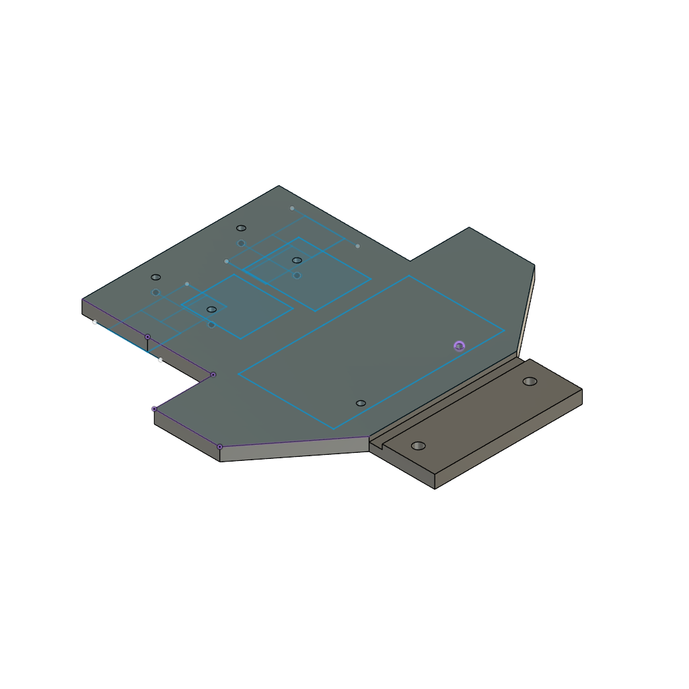

# mechanische tekening - plan B

* **3D-model**: [robot.f3d](robot.f3d) (Autodesk Fusion 360). Open het in Fusion via **Bestand → Openen → Openen vanaf mijn computer**.
* printout: [mechanisch_planB.pdf](mechanisch_planB.pdf)
* tekening als bronbestand: [mechanisch_planB.svg](mechanisch_planB.svg) (gegenereerd door [../tools/genereer_tekeningen.js](../tools/genereer_tekeningen.js) op basis van de geometrie in robot.f3d)

## bodemplaat (3D print)

Eén 3D-geprinte plaat van **4 mm** dik is het chassis. Op de plaat zijn de posities van de onderdelen geschetst.

| zone (vanaf de voorkant, in mm) | breedte | functie |
|---|---|---|
| 0 .. 20 | 48 | **sensorbalk** met gleuf. De Yahboom-sensor hangt eronder. |
| 20 .. 40 | 48 → 96 | schuine overgang (minder massa vooraan) |
| 40 .. 60 | **96** | breedste deel: ESP32 DevKit (29 x 52, dwars) |
| 60 .. 100 | 60 | achterstuk met **uitsparingen voor de wielen** (wielen binnen de 96 mm), DRV8833 en MT3608 bovenop, N20-motoren eronder |

## layout

| onderdeel | positie (vanaf de voorkant, in mm) | waarom |
|---|---|---|
| Yahboom 8-kanaals sensor (onder) | x ≈ 10 | zo ver mogelijk voor de wielas |
| ESP32 DevKit | x = 27 .. 56 | midden op de plaat, USB en BOOT-knop (start/stop) bereikbaar |
| DRV8833 + MT3608 | x = 61 .. 83 | dicht bij de motoren en de batterij: **korte vermogendraden** |
| wielas (2x N20 onder de plaat) | x = 80 | wielen in de uitsparingen, dus de robot is niet breder dan de plaat |
| LiPo 50 x 60 mm | onder of op de plaat, net voor de wielas | zwaartepunt dicht bij de wielen (grip) |
| ball caster | x ≈ 30 (onder) | draagt de voorkant |

## maten

* L x B x H: **100 x 96 x ± 41 mm**, dus **past onder de chronobrug** (12 x 12 cm)
* afstand wielas → sensor: **70 mm**. De richtlijn uit het leerpad is 8-12 cm. Een langere sensorbalk (bv. +20 mm) laat de robot bochten vroeger zien en geeft meer stabiliteit bij hoge snelheid.
* wieldiameter 34 mm, wielas ± 17 mm boven de grond
* sensorhoogte boven de baan: ± 3 mm (afstelbaar met afstandhouders)
* massa: ± 150 g

> De maten zijn afgeleid uit de geometrie in robot.f3d (± 1 mm). De Fusion-schetsen bevatten geen posities voor de LiPo en de ball caster, dus die zijn indicatief.

## printinstellingen (richtwaarde)

* PLA of PETG, laaghoogte 0,2 mm, 3 wanden, 25-30 % infill
* plat printen (de 4 mm-zijde verticaal), geen support nodig
* gaten Ø3 mm (M3): na het printen eventueel ruimen met een boortje van 3 mm

## spoiler

De specificaties zeggen *"spoilers niet vergeten!!"* 😉. Achteraan kan je een kleine geprinte spoiler monteren. Hij mag niet hoger komen dan 12 cm.
