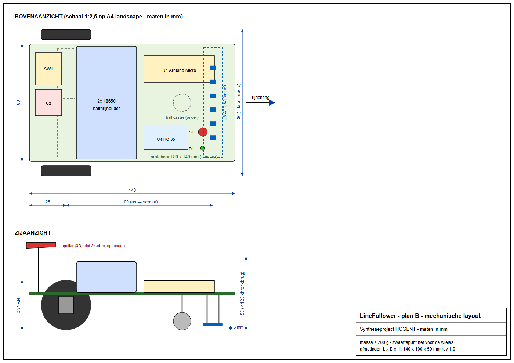

# mechanische tekening - plan B

* printout: [mechanisch_planB.pdf](mechanisch_planB.pdf)
* origineel bestand: [mechanisch_planB.svg](mechanisch_planB.svg) (gegenereerd door [../tools/genereer_tekeningen.js](../tools/genereer_tekeningen.js))

## layout

| onderdeel | positie (vanaf achterkant print, in mm) | waarom |
|---|---|---|
| wielas (2x N20 onder de print) | x = 25 | aandrijving achteraan, sensor zo ver mogelijk vooraan |
| batterijhouder 2x 18650 (dwars) | x = 32 .. 73 | zwaarste onderdeel **net voor de wielbasis** → stabiel, genoeg grip op de wielen |
| DRV8833 + SW1 | x = 4 .. 22 | **korte vermogendraden** tussen batterij, h-brug en motoren |
| Arduino Micro + HC-05 | x = 78 .. 126 | bovenop, USB-poort bereikbaar |
| ball caster (onder) | x = 104 | draagt de voorkant, net achter de sensor |
| QTR-8A sensor (onder) | x = 125 (= **100 mm voor de wielas**) | richtlijn 8-12 cm: vroeg bijsturen bij hoge snelheid |
| start/stop knop + power led | vooraan rechts | goed bereikbaar bij het starten op de baan |

## maten

* print (chassis): 80 x 140 mm protoboard, 1,6 mm dik
* totale breedte over de wielen: ± 100 mm → **past onder de chronobrug** (12 cm breed)
* totale hoogte: ± 50 mm (hoogste punt = batterijhouder) → **< 12 cm**
* sensorhoogte boven de baan: **3 mm** (via M3 afstandhouders, bijstellen met ringetjes)
* wieldiameter 34 mm, wielbreedte 7 mm
* massa: ± 200 g

## spoiler

De specificaties zeggen *"spoilers niet vergeten!!"* 😉. Achteraan kan je een kleine spoiler (3D print of stevig karton) op een staafje monteren. Hij mag niet hoger komen dan 12 cm.
